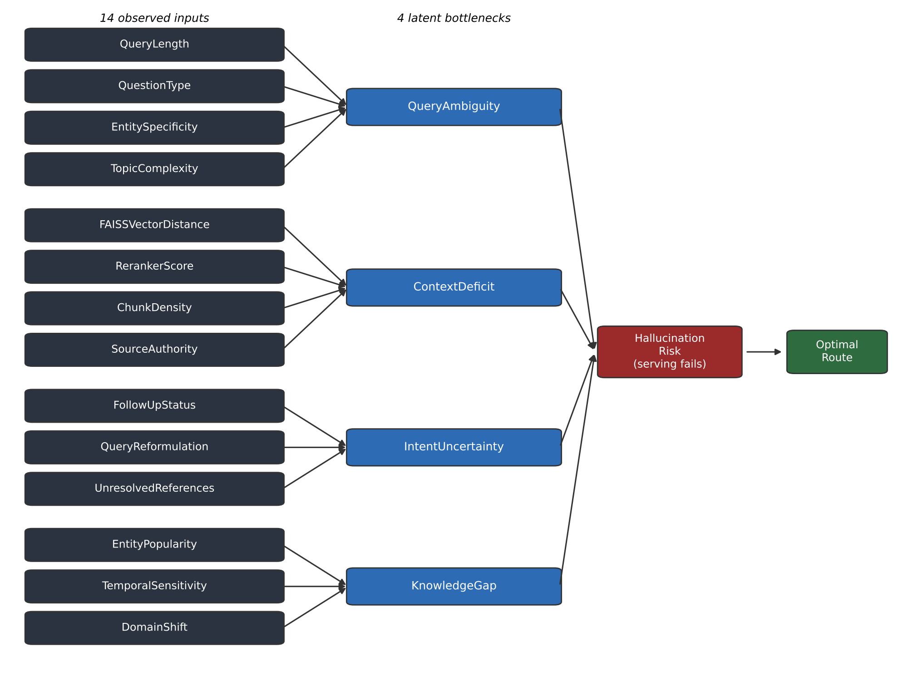
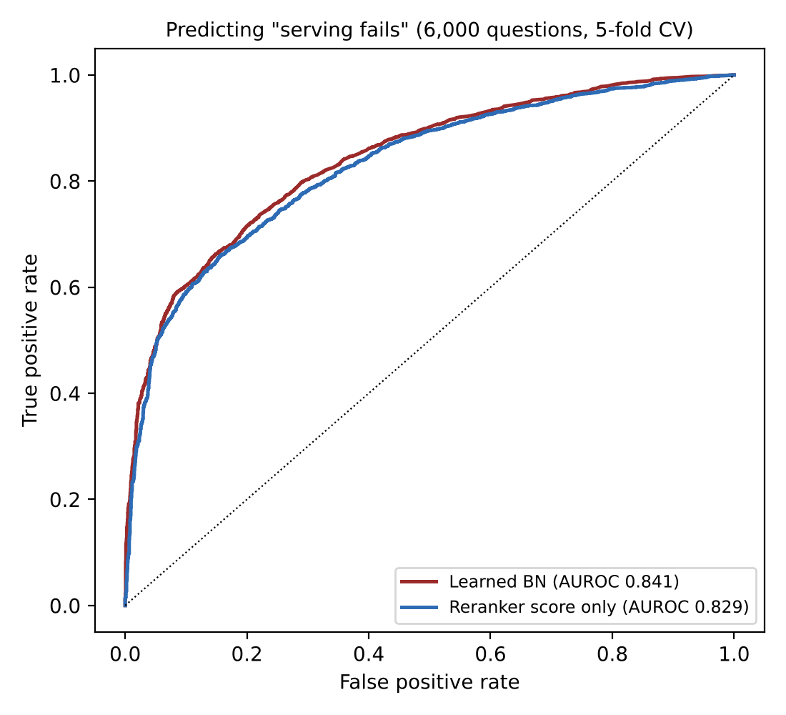
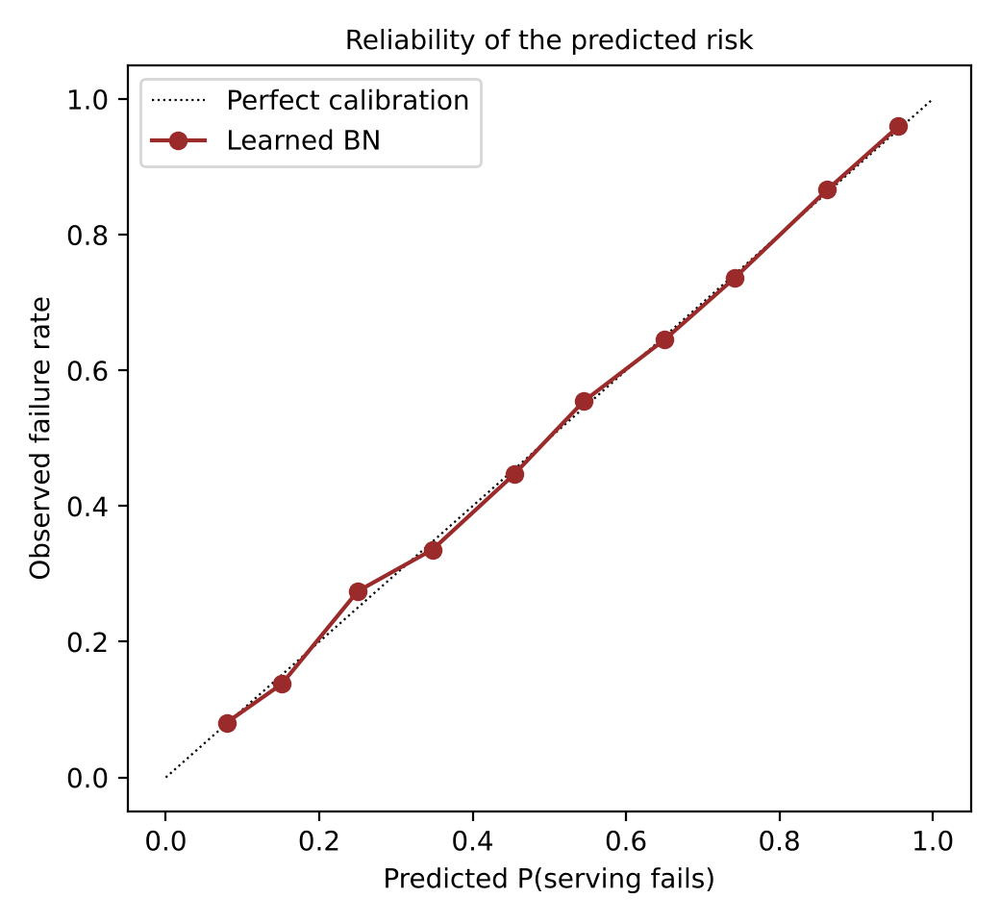

# Bayesian Epistemic Routing for RAG Pipelines

A Bayesian network that decides, **before** the language model answers, whether a RAG system should
**Serve** (answer now), **Search** (retrieve more first) or **Clarify** (ask the user), and explains *why*
by diagnosing which kind of uncertainty is to blame.

Standard RAG pipelines route with fixed if-else thresholds on a similarity score, so they answer confidently
even when the retrieved context is unrelated. This project replaces that with a learned probabilistic model of
**P(the answer will be wrong)**, computed from 14 cheap signals about the query, the retrieved passages and the conversation.

**Highlights**
- Learned from **6,000 questions** (PopQA, HotpotQA, CoQA) labelled by running Qwen2.5-7B-Instruct on Kaggle and grading against the gold answers.
- **AUROC 0.841** for predicting a wrong answer (5-fold CV), against 0.707 for the hand-set network and 0.815 for logistic regression; it degrades more gracefully than a non-retrained model when retrieval signals are missing.
- Calibrated at the serve threshold: **19% of served answers fail**, against 33% for gradient boosting at the same operating point.
- Exact inference, interpretable CPTs, and a per-question diagnosis (QueryAmbiguity, ContextDeficit, IntentUncertainty, KnowledgeGap).
- A **clarify loop** that resolves references like "he" or "it" from the conversation before deciding.
- **v3 (in progress, [`v3/`](v3/))**: a causal, decision-theoretic redesign with 9 failure causes, 6 actions (Serve, Rewrite, Search, Decompose, Clarify, Abstain) and value-of-information routing.

*Team project at Amrita Vishwa Vidyapeetham, Chennai: Girish Shiva Ramakrishnan, Gogulakrishnan, Saran Karthik. Guide: Dr. Prasanna Kumar R.*

| ROC (5-fold CV) | Calibration |
|---|---|
|  |  |

## 1. The idea in one picture

    14 input signals  ->  4 hidden bottlenecks  ->  HallucinationRisk  ->  OptimalRoute
    (measured from the     QueryAmbiguity            (P that serving        Serve / Search /
     query, passages,      ContextDeficit             now fails)             Clarify
     conversation)         IntentUncertainty
                           KnowledgeGap

20 nodes, 19 edges. "High" means trouble on every node.

## 2. Two stages

**Offline (already done, results are in `labels/` and `profiles/`)**
1. Build a knowledge base of Wikipedia passages (`build_kb.py`, `build_hybrid.py`).
2. Run Qwen2.5-7B-Instruct on 6,000 questions (PopQA 3,000, HotpotQA 1,500, CoQA 1,500) on Kaggle.
   Each question is graded against the dataset's true answer (`label_dataset.py`, `regrade_labels.py`).
   Failure = wrong answer OR "I don't know". The true answer is never shown to Qwen.
3. Learn the network from those labels (`learn_bn.py`): information-gain cut-offs, then MAP-EM.
4. Compare against other models and test end to end (`compare_routers.py`, `eval_*.py`).

**Online (the demo)**
Question -> measure 14 signals -> apply learned cut-offs -> infer P(fail) -> diagnose the blame
-> Serve / Search / Clarify -> answer.

## 3. File guide

### Core: needed to run the demo
| File | What it does |
|---|---|
| `demo.py` | Interactive demo and `--script` mode. Ties everything together and prints the signals, P(fail), diagnosis and route. |
| `learn_bn.py` | The learning and inference engine. Information-gain cut-offs, MAP-EM, exact inference over the 16 bottleneck combinations, diagnosis, `choose_threshold`, `decide`, `route`. Also loads and saves profiles. |
| `bayesian_epistemic_routing.py` | The hand-set network (pgmpy), used as the prior and as the EM starting point. Defines nodes, edges and the initial CPTs. |
| `feature_extractors.py` | Measures the 14 signals: reranker score, FAISS similarity, chunk density, source authority, query length, specificity, unresolved references, domain shift, and so on. Also holds `KnowledgeBase`. |
| `clarify_loop.py` | Conversation memory, detects references like "he" or "it", merges the user's clarification into the query. |
| `llm_backends.py` | Builds the RAG prompt and talks to the language model (Ollama / OpenAI-compatible, or none). |
| `search_action.py` | The Search action: pulls live Wikipedia passages and re-ranks them. |
| `requirements.txt` | Python dependencies. |
| `profiles/Qwen_...bfloat16.json` | The learned network used by the demo (cut-offs, CPTs, threshold tau = 0.369, PopQA-only). |
| `kb/` | PopQA knowledge base: `docs.jsonl`, `embeddings.npy`, `centroids.npy`, `popularity.json`, `questions.jsonl`. |

### Learning and labelling (reproduces the results)
| File | What it does |
|---|---|
| `label_dataset.py` | Runs the LLM over every question, extracts the signals, and grades answers with `grade()`. |
| `regrade_labels.py` | Re-grades existing labels with the improved grader (whole-word match, abstain never correct, close-match and stop-word handling) without re-running the LLM. |
| `merge_labels.py` | Merges part files produced by parallel Kaggle runs into one label file. |
| `checkpoint.py` | Saves progress during long labelling runs so a crash does not lose work. |
| `build_kb.py` | Builds the PopQA knowledge base from Wikipedia and page-view popularity. |
| `build_hybrid.py` | Builds the combined knowledge base for PopQA + HotpotQA + CoQA. |
| `labels/` | Graded labels: PopQA run and the hybrid (combined) run. |
| `profiles/..._combined.json` | Network learned from all 6,000 questions (tau = 0.305). |

### Evaluation
| File | What it does |
|---|---|
| `compare_routers.py` | 5-fold cross-validation: our network vs hand-set vs reranker only vs logistic regression vs gradient boosting; AUROC, calibration, missing-signal test. |
| `eval_end_to_end.py` | A: always answer. B: answer, then search if "I don't know". C: ours (route first). Reports accuracy, LLM calls and time. |
| `eval_clarify.py` | Tests the Clarify route on CoQA with a simulated user. |

## 4. How to run

    python -m venv venv && source venv/bin/activate
    pip install -r requirements.txt
    python -m spacy download en_core_web_sm
    ollama pull qwen2.5:7b            # keep the Ollama app running

    python demo.py                    # interactive
    python demo.py --script           # prepared examples
    python demo.py --llm none         # routing only, no answers
    python demo.py --script --no-web  # without live Wikipedia

Reproduce the learning and results:

    python learn_bn.py labels/Qwen_Qwen2.5-7B-Instruct-bfloat16.jsonl
    python compare_routers.py labels/Qwen_Qwen2.5-7B-Instruct-bfloat16.jsonl
    python eval_end_to_end.py labels/Qwen_Qwen2.5-7B-Instruct-bfloat16.jsonl --n 200

## 5. Key results

- 5-fold CV AUROC 0.841 (hand-set 0.707, reranker only 0.829, logistic regression 0.815, gradient boosting 0.856).
- Per dataset: PopQA 0.852, CoQA 0.826, HotpotQA 0.696.
- 19.2% of served answers fail (gradient boosting: 33% at the same operating point).
- With signals missing: 0.649 (ours), 0.665 (LR retrained), 0.563 (LR not retrained).
- PopQA end to end (200 questions): always-answer 47.5%, ours 51.5% at 1.00 LLM call per question.
- CoQA clarify (200): raw 13%, always-rewrite 45.5%, ours 37%, ours with conversation search 44%.

## 6. Honest limitations

- 7B model on 2x T4 only. The router is model-agnostic: relabel with a larger model and re-run EM.
- Entity popularity carries little information here (0.016 bits).
- HotpotQA is weakest (multi-hop questions are sent to Clarify because of the Topic Complexity design).
- Always-rewrite is slightly ahead of our selective Clarify on CoQA. The user in the clarify test is simulated.
- Gradient boosting ranks slightly better but is not calibrated at the served threshold.

## 7. Not included (large, regenerable)

`data/` (raw PopQA, QReCC), `kb_hybrid/` (rebuild with `build_hybrid.py`), `wiki_cache.jsonl`, part files, and report/slide files.

## 8. The 6,000 labelled questions

`labels/all_6000_labels.jsonl` is the full labelled dataset (PopQA 3,000 + HotpotQA 1,500 + CoQA 1,500),
one row per question: the 14 raw signals, Qwen's answer, and the graded outcome. It is the two files
`...bfloat16.jsonl` (PopQA) and `...bfloat16__kb_hybrid.jsonl` (HotpotQA + CoQA) joined together.
The combined network is learned from both:

    python learn_bn.py labels/Qwen_Qwen2.5-7B-Instruct-bfloat16.jsonl labels/Qwen_Qwen2.5-7B-Instruct-bfloat16__kb_hybrid.jsonl

## 9. Other scripts

| File | What it does |
|---|---|
| `diagnose_model.py` | Inspects a learned profile: CPTs, cut-offs, which signals carry information. |
| `compare_labels.py`, `precision_check.py` | Sanity checks on the labelling and the grader. |
| `eval_qrecc_merge.py` | Clarify-loop evaluation on QReCC conversational questions. |
| `plot_network.py` | Draws the network diagram. |
| `test_extractors.py`, `smoke_test_gpu.py` | Tests for the signal extractors and the GPU labelling setup. |
| `modal_label.py`, `label_on_kaggle.ipynb`, `label_on_colab.ipynb`, `label_hybrid_kaggle.ipynb` | Running the labelling on Modal, Kaggle (2x T4) or Colab. |
