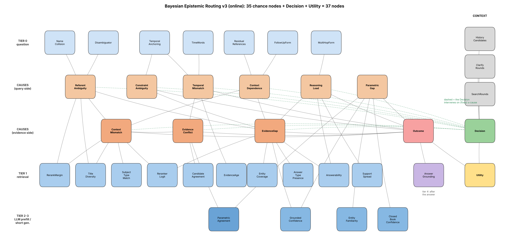

# Bayesian Epistemic Routing v3

A causal, decision-theoretic Bayesian network that decides, for each question to a RAG system, whether to
**Serve** (answer now), **Rewrite** (resolve it from the conversation), **Search** (web), **Decompose**
(multi-hop), **Clarify** (ask the user) or **Abstain**, and says *why* (a posterior over 9 failure causes).

## Files

| File | What it is |
|---|---|
| `ber_v3.py` | The network: 9 causes, 22 symptoms, 3 context nodes, outcome, actions as interventions, utility. Exact inference over the 512 cause combinations, anytime routing (value of measuring the next tier), post-answer check. `python ber_v3.py` runs the sanity scenarios. |
| `learn_v3.py` | Learning: cut-offs, EM with weak cause labels, Dirichlet prior strength by grouped CV, random restarts, action effects, lambda from a target risk. |
| `recovery_test.py` | Parameter recovery on data from a known "true" network (proves the hand-set numbers do not decide the result once weak labels exist). Results in `recovery_results.txt`. |
| `signals_v3.py` | Tier-0 (question) and tier-1 (retrieval) signal extractors. |
| `llm_probe_v3.py` | Tier-2/3 signals from the answering LLM via llama.cpp's server (P("I don't know") by teacher forcing, entity familiarity, closed-book answer). |
| `build_title_index.py` | Wikipedia title index for NameCollision. |
| `test_signals_v3.py` | Hand-picked checks; `--models` also checks the real reranker and QA models. |
| `kaggle/smoke_test_qwen35_9b.ipynb` | Kaggle (2×T4) smoke test of Qwen3.5-9B Q4_K_M with llama.cpp: thinking off, probe sanity, throughput, labelling-time estimate. |
| `NODE_SPEC_v3.md`, `make_spec.py`, `plot_v3.py` | Generated node specification and diagram. |

## Decisions

- **Answering LLM:** Qwen3.5-9B, `unsloth/Qwen3.5-9B-GGUF` file `Qwen3.5-9B-Q4_K_M.gguf`, thinking off.
  The SAME file is used for labelling (Kaggle) and the local demo (RTX 3050, 8 GB), so the learned network
  describes the deployed model. A second run with Qwen3.5-27B on a subset tests model independence (only the
  Outcome table, the 4 LLM-signal tables and the action effects depend on the LLM).
- **Grader:** a stronger model (Qwen3.5-27B) as LLM judge plus Wikidata aliases; never deployed.
- **Web search:** Tavily, every response cached to disk (paid once, reproducible).
- **Datasets:** standard benchmarks with official splits (AmbigQA, AmbigDocs, SituatedQA, FreshQA, QReCC,
  TopiOCQA, MuSiQue, 2WikiMultihopQA, PopQA, ClashEval).
- **lambda:** not learned; chosen from a target share of wrong answers among served ones (`choose_lambda`).

## Validation so far

- Network: 9/9 sanity scenarios route as designed; pgmpy `check_model` passes.
- Learning (`recovery_test.py`, 8,000 synthetic questions): with weak labels on 30% of questions, a random
  start and the hand-set start give the same network (distance 0.0001) and agree with the true router on
  98.5% of decisions; without labels, a random start loses the meaning of the causes (38-56% accuracy).
  Action effects need their own data (run every action on the same subset).
- Tier-0 signals on held-out real questions (old PopQA/HotpotQA/CoQA labels, not used for tuning):
  MultiHopForm flags 57% of HotpotQA bridge and 64% of comparison questions, 0.1% of PopQA single-hop
  questions; FollowUpForm fires on 71% of CoQA follow-ups and never on first turns. These are noisy
  symptoms by design: the network learns P(symptom | cause), including how often they miss.
- Tier-1 signals: logic checked with stand-in models (62/62 checks); real models are checked in the
  Kaggle notebook (`test_signals_v3.py --models`).

## Run

    pip install numpy scipy scikit-learn pgmpy networkx matplotlib spacy rapidfuzz transformers torch
    python -m spacy download en_core_web_sm
    python ber_v3.py            # network + scenarios
    python test_signals_v3.py   # signal checks
    python recovery_test.py     # ~15 min
